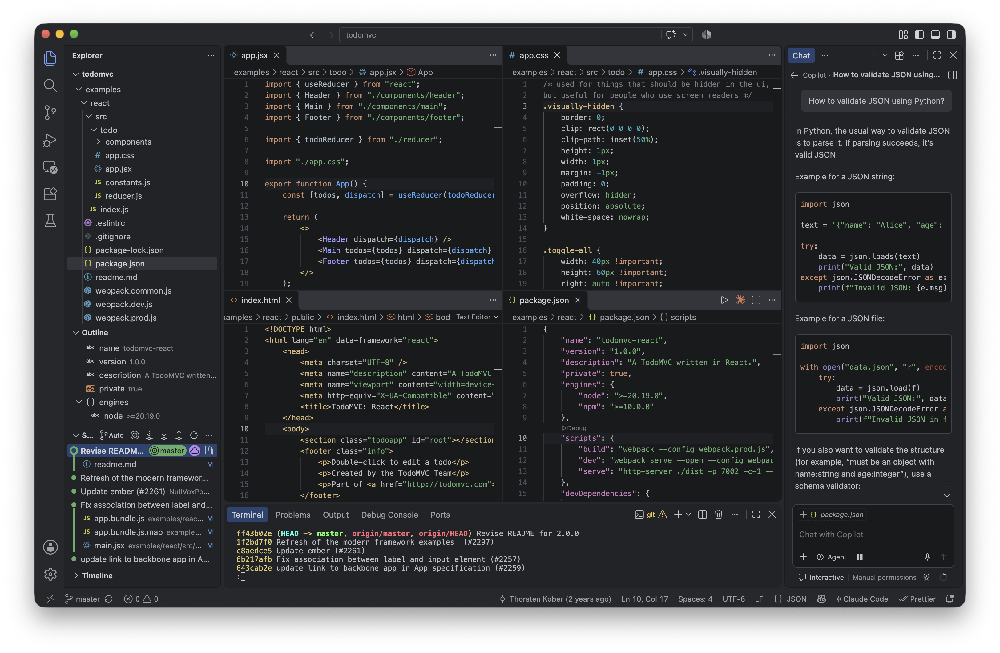
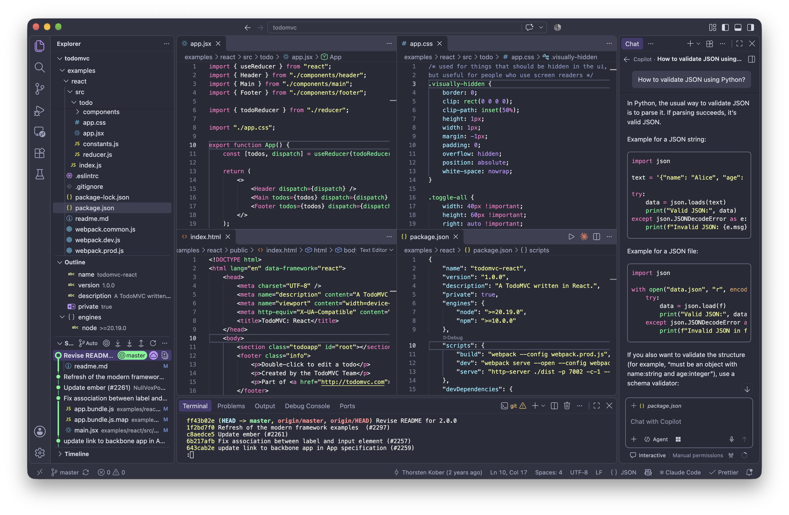

# Classical Dark Theme

A simple dark theme for Visual Studio Code inspired by the classic color scheme.

Two variants are included:

- **Classical Dark**: neutral charcoal
- **Classical Dark Midnight**: deep midnight blue

## Preview

### Classical Dark



### Classical Dark Midnight



## Installation

1. Open the Extensions view (`Ctrl+Shift+X` / `Cmd+Shift+X`).
2. Search for **Classical Dark Theme** and click **Install**.
3. Open the Command Palette (`Ctrl+Shift+P` / `Cmd+Shift+P`), run **Preferences: Color Theme**, and pick a variant.

## Customization

### Show constant variables in the default text color

By default, constant variables (for example `const` in JavaScript/TypeScript) get the constant color. To show them in the same color as regular variables (`let`), add this to your user `settings.json`:

```jsonc
{
  "editor.tokenColorCustomizations": {
    "[Classical Dark]": {
      "textMateRules": [
        {
          "scope": ["variable.other.constant", "entity.name.constant"],
          "settings": { "foreground": "#BCBEC4" },
        },
      ],
    },
    "[Classical Dark Midnight]": {
      "textMateRules": [
        {
          "scope": ["variable.other.constant", "entity.name.constant"],
          "settings": { "foreground": "#F8F8F2" },
        },
      ],
    },
  },
  "editor.semanticTokenColorCustomizations": {
    "[Classical Dark]": {
      "rules": {
        "variable.readonly": "#BCBEC4",
        "variable.constant": "#BCBEC4",
      },
    },
    "[Classical Dark Midnight]": {
      "rules": {
        "variable.readonly": "#F8F8F2",
        "variable.constant": "#F8F8F2",
      },
    },
  },
}
```

Enum members, numbers, booleans and other constants keep their theme colors.

## Build from Source

```bash
npm install
npm run build     # generate themes/*.json from src/
npm run package   # create a .vsix
```

## License

[MIT](LICENSE.md)
